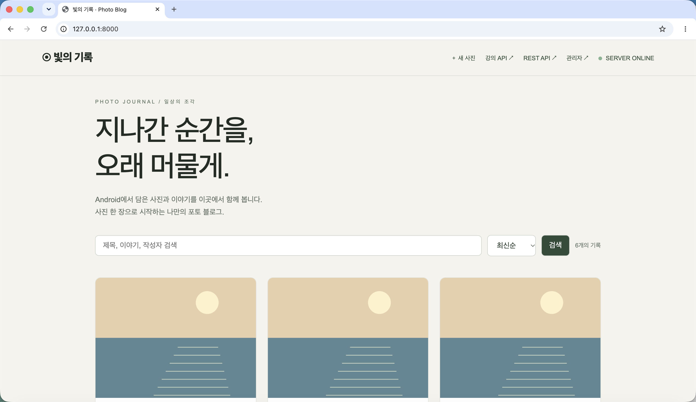

# 빛의 기록 · Photo Blog

모바일웹서비스프로그래밍 공통평가 01. Django REST API와 Java Android 클라이언트로 사진과 이야기를 등록하고 동기화합니다.

제출 저장소: https://github.com/5eungwon/mwp-middleexam01

[Word 수행 결과 보고서](<모바일웹서비스 프로젝트_공통평가 01_수행 결과 보고서.docx>)



## 폴더 구조

```text
ROOT/
├── PhotoBlogServer/   # Django 5.2 + DRF + SQLite
├── PhotoViewer/       # Java Android 앱 + Gradle Wrapper
├── 모바일웹서비스 프로젝트_공통평가 01_수행 결과 보고서.docx
├── docs/             # 캡처, 검증 로그, PythonAnywhere 배포 절차
└── scripts/          # 실제 HTTP 검증, 캡처, Word 생성 도구
```

보고서는 사용자가 제공한 원본 Word 표 양식을 유지해 작성했습니다. 증빙 사진 24장은 표의 각 관련증빙 칸에 작은 표시 크기로 넣고, 원본 이미지 바이트·해상도를 그대로 보존했습니다. 문서의 자동 이미지 압축도 껐습니다.

## 제공 자료 반영

제공된 ch05 강의와 Word 양식의 항목을 [요구사항 대조표](docs/ASSIGNMENT.md)에 정리했습니다.

- 강의 경로 `/api_root/Post/`는 **JSON Array**로 응답합니다. 숫자 author와 created_date/published_date 필드를 제공합니다.
- `/post/new/`의 실제 웹 POST 작성/게시 완료 화면을 주소창과 함께 캡처했습니다.
- 실제 Terminal TCP 검증, CodeBeautify 검증, Socket Server 수신 파일의 VS Code 화면을 준비했습니다.
- 자동 테스트 **17개 통과**, 분기 포함 **Code Coverage 98%**. [HTML 보고서](docs/coverage/index.html).
- Android는 RecyclerView/ImageAdapter, 강의 API 기본 동기화 및 입력 폼 기반 Upload(상)을 구현했습니다.
- PythonAnywhere에 새 Django 서버를 배포했습니다: https://asdfgh0986.pythonanywhere.com . 로그인·업로드·수정·삭제의 실제 HTTPS 검증과 Android 동기화 증빙을 포함합니다. 기존 소스·DB와 복구 설정은 별도 보존했습니다.

[검증한 디버그 APK 다운로드](docs/downloads/PhotoViewer-debug.apk)

## 실행: Django 서버

Python 3.12 이상을 권장합니다.

```bash
python3.12 -m venv .venv
source .venv/bin/activate
pip install -r PhotoBlogServer/requirements.txt
cd PhotoBlogServer
python manage.py migrate
python manage.py createsuperuser
python manage.py seed_demo
python manage.py runserver 0.0.0.0:8000
```

- 갤러리: http://127.0.0.1:8000/
- 강의 API 브라우저: http://127.0.0.1:8000/api_root/Post/
- 확장 API 브라우저: http://127.0.0.1:8000/api/posts/
- 웹 사진 게시: http://127.0.0.1:8000/post/new/
- 관리자: http://127.0.0.1:8000/admin/
- `seed_demo`: Pillow로 직접 그린 풍경 3장, 비밀번호 없는 demo 작성자를 생성합니다. 사진은 일러스트이며 실제 촬영 사진이 아닙니다.
- 앱 로그인에는 `createsuperuser`로 만든 계정을 사용합니다. 별도 사용자 계정은 관리자에서 추가할 수 있습니다.

[검증한 디버그 APK 다운로드](docs/downloads/PhotoViewer-debug.apk)

## 실행: Android

1. Android Studio에서 `PhotoViewer` 폴더를 엽니다. JDK 17 이상, Android SDK 36을 준비합니다.
2. Android Studio가 로컬 SDK 경로(`local.properties`)를 생성하게 합니다. 이 파일은 Git에 포함되지 않습니다.
3. 에뮬레이터에 앱을 실행합니다. 기본 서버 주소는 `http://10.0.2.2:8000`이며 강의 경로 `/api_root/Post/`를 사용합니다.
4. **동기화**를 누르면 공개 목록을 받습니다.
5. **설정 → 사용자명/비밀번호 → 로그인**을 진행합니다.
6. **사진 올리기 → 제목·이야기 입력 → 사진 선택 → 업로드**를 진행합니다.
7. 브라우저를 새로고침하면 같은 사진이 보입니다.

실기기는 USB 디버깅 연결 후 `adb reverse tcp:8000 tcp:8000`을 실행하고 앱 설정에 `http://127.0.0.1:8000`을 입력합니다. PythonAnywhere는 HTTPS 주소를 입력합니다. 서버를 변경하면 이전 인증 정보와 목록 캐시는 삭제됩니다.

```bash
cd PhotoViewer
./gradlew :app:assembleDebug :app:lintDebug
# APK: app/build/outputs/apk/debug/app-debug.apk
```

검증 환경: macOS arm64, Python 3.12, Django 5.2.18, DRF 3.16.1, Java 21, Gradle 8.14.3, AGP 8.10.1, Pixel 7 Android 15(API 35). targetSdk=35이며 Android 16 실기기 검증은 하지 않았습니다. Lint 잔여 경고는 최신 targetSdk/Gradle 안내를 확인합니다.

## API 계약

| 메서드 | URL | 설명 / 정상 응답 |
| --- | --- | --- |
| GET | `/api/health/` | 서비스·DB 상태, 200 |
| POST | `/api/token/` | username, password → token, 200 |
| GET | `/api_root/Post/` | 강의 JSON Array, 200 |
| POST | `/api_root/Post/` | 강의 multipart 업로드, 201 |
| GET | `/api/posts/` | 확장 count/next/previous/results, 200 |
| GET | `/api/posts/{id}/` | 사진 상세, 200 |
| POST | `/api/posts/` | multipart title, text, image → 201 |
| PUT/PATCH | `/api/posts/{id}/` | 작성자만 수정, 200 |
| DELETE | `/api/posts/{id}/` | 작성자만 삭제, 204 |

쓰기 요청 헤더: `Authorization: Token 발급받은토큰`.
조회는 공개, 쓰기는 로그인 필요(401), 타인 기록 수정/삭제는 403, 필수값/잘못된 사진은 400, 없는 사진은 404입니다.
`title`: 공백 제외 필수, 100자 이하. `text`: 선택, 2,000자 이하. 사진: JPEG/PNG/WEBP, 10MB/2,500만 화소 이하. 서버가 실제 이미지 바이트도 검사합니다.
검색: `?search=검색어`, 정렬: `?ordering=-created_at|created_at|title`, 페이지: `?page=2` (6개 단위).

## 평가에 제출하는 Client 편의 기능 (5개)

1. 기기별 즐겨찾기 저장과 현재 목록 필터.
2. 서버 주소 설정·로그인 UI와 강의/확장 API 모드 선택.
3. 최근 목록 캐시로 앱 재실행 시 이전 목록 표시. 사진은 네트워크 수신.
4. 내 사진 제목·이야기 수정 UI. 서버의 기존 PATCH API 사용.
5. 삭제 전 제목과 확인/취소 버튼을 보여주는 UI. 서버의 기존 DELETE API 사용.

검색·페이지 이동은 확장 API의 기본 제공 기능으로 유지하며 위 5개 편의 기능 평가와 별도로 설명합니다.

## 검증과 보고서

```bash
source .venv/bin/activate
pip install -r PhotoBlogServer/requirements-test.txt
pip install -r scripts/requirements.txt
cd PhotoBlogServer
python -m coverage run manage.py test -v 2
python -m coverage report
python -m coverage html
python manage.py makemigrations --check --dry-run
cd ..
# 서버가 8000번 포트에서 실행 중일 때:
python scripts/verify_raw_http.py
python scripts/verify_http.py
python scripts/capture_web.py
# macOS 실제 Chrome 주소창 포함 캡처 (별도 테스트 계정 파일 필요):
# python scripts/capture_assignment.py
python scripts/build_report.py
python scripts/verify_report_images.py
```

`verify_http.py`는 로컬 DB에 http-verifier 사용자를 만들고 테스트 사진을 생성·수정·삭제합니다. 실행 데이터는 SQLite/미디어에 남으므로 운영 서버에는 실행하지 않습니다. Android 증거는 실제 adb 스크린샷입니다. 테스트 계정 비밀번호/토큰과 DB/업로드 미디어는 저장소에서 제외합니다.

- 캡처와 원본 로그: [docs/evidence](docs/evidence)
- PythonAnywhere 배포: [docs/PYTHONANYWHERE.md](docs/PYTHONANYWHERE.md)
- GitHub Actions: 서버 테스트 및 Android 빌드/Lint 설정 포함. 원격 Actions 실행 결과는 별도 확인해야 합니다.

참고한 공식 문서: [DRF multipart parser](https://www.django-rest-framework.org/api-guide/parsers/), [DRF 테스트](https://www.django-rest-framework.org/api-guide/testing/), [Android 문서 선택](https://developer.android.com/training/data-storage/shared/documents-files), [PythonAnywhere Django 배포](https://help.pythonanywhere.com/pages/DeployExistingDjangoProject/).


## 강의 24쪽 Socket Server 재현

서버 :8000을 실행한 상태에서 별도 터미널에 `python scripts/socket_capture.py`를 실행합니다. 앱 서버를 `http://10.0.2.2:8001`로 변경하고 로그인한 뒤 동기화를 누르면 `docs/evidence/07-android-request.http`에 실제 요청 헤더가 저장됩니다. 확인 후 앱을 :8000으로 되돌립니다. 토큰은 저장 전에 마스킹하며 로그인 요청 본문은 기록하지 않습니다.

`capture_assignment.py`는 macOS Chrome 전체 창을 캡처하는 실행 기록 도구입니다. `/tmp/photoblog-test-credentials.json`(username/password)과 `/tmp/AndroidUpload.jpg` 테스트 이미지가 필요하며, 이 임시 파일은 Git에 올리지 않습니다. 일반 사용자는 README의 수동 실행 절차로도 동일하게 검증할 수 있습니다. 보고서 생성에는 저장소에 포함된 원본 Word 양식과 증빙 이미지가 사용됩니다.
